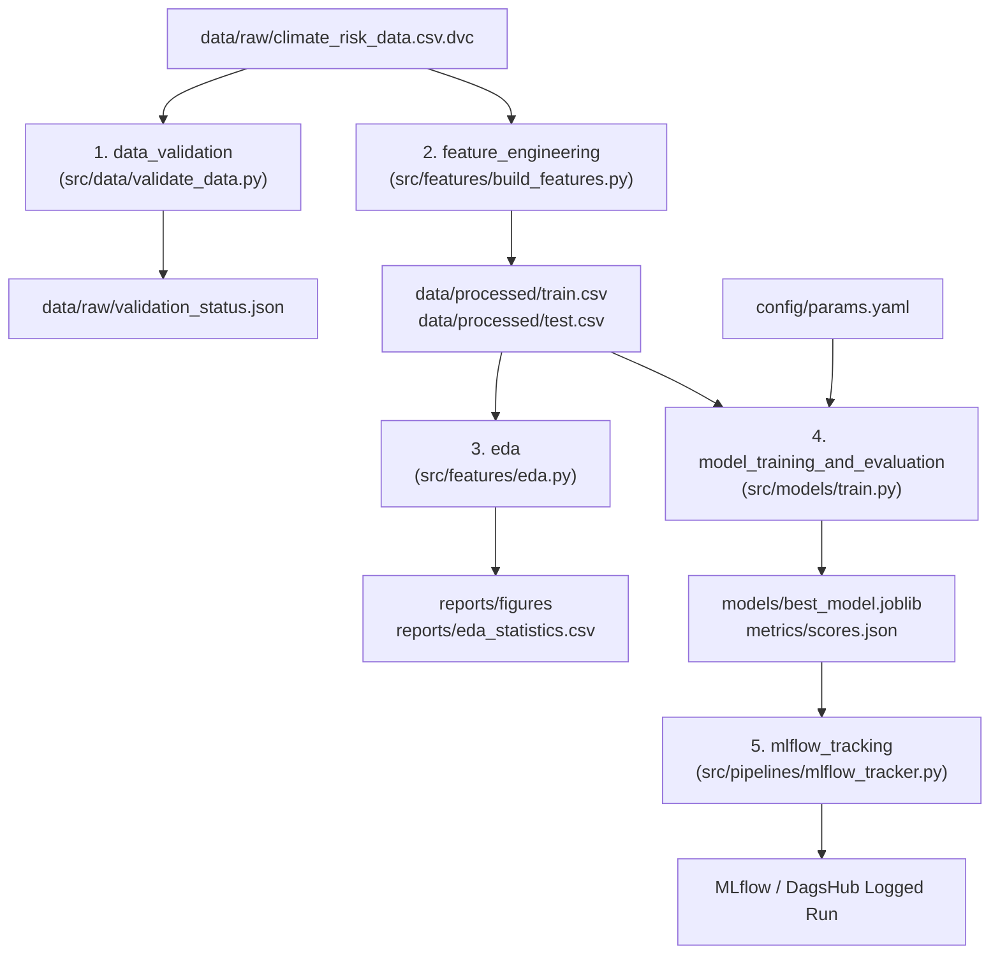

# 🌍 Climate Risk Prediction System

An end-to-end production-grade Machine Learning Operations (MLOps) system designed to predict climate-related environmental risks (extreme heatwaves, flooding rainfalls, severe windstorms, and droughts) using real historical multi-variate climate observations across Indian climate zones.

---

## 📌 Project Architecture & MLOps System Design

```
Climate-Risk-Prediction/
├── .dvc/                         # DVC system configuration & remote definitions
│   └── config                    # Local and DagsHub DVC storage endpoints
├── .github/
│   └── workflows/
│       └── ci.yaml               # GitHub Actions CI workflow
├── .venv/                        # Dedicated Python 3.11 virtual environment
├── config/
│   ├── config.yaml               # Central paths, features & drift thresholds
│   └── params.yaml               # Model hyperparameters & training configs
├── data/
│   ├── raw/
│   │   ├── climate_risk_data.csv.dvc # DVC pointer tracking raw dataset
│   │   ├── dataset_provenance.json   # License, coordinates, and origin metadata
│   │   └── validation_status.json    # Automated schema & bounds validation report
│   ├── processed/                # Preprocessed temporal train/test datasets
│   ├── reference/                # Baseline data for drift detection (Phase 4)
│   └── current/                  # Production inference data for monitoring (Phase 4)
├── metrics/                      # Evaluation scores, confusion matrices, comparison tables
│   ├── confusion_matrix.png      # Best model confusion matrix
│   ├── model_comparison.csv      # 5-model benchmark metrics
│   └── scores.json               # Detailed classification report
├── models/                       # Trained models & scalers
│   ├── best_model.joblib         # Complete inference pipeline (Preprocessor + Estimator)
│   └── preprocessor.joblib       # Standalone scikit-learn ColumnTransformer
├── reports/                      # EDA, monitoring & explainability reports
│   ├── figures/                  # Correlation, thermal, rainfall, and risk plots
│   ├── monitoring/               # Evidently AI HTML and summary JSON reports
│   │   ├── data_drift_report.html
│   │   ├── target_drift_report.html
│   │   ├── model_performance_report.html
│   │   └── latest_monitoring_dashboard.json
│   └── explainability/           # SHAP beeswarm, bar, and event plots
│       ├── shap_summary_beeswarm.png
│       ├── shap_feature_importance_bar.png
│       ├── shap_local_heatwave_explanation.png
│       ├── shap_local_flood_explanation.png
│       └── shap_summary.json
├── src/                          # Modular production source code
│   ├── data/
│   │   ├── load_data.py          # Data collection & provenance tracking
│   │   └── validate_data.py      # Schema, physical bounds & integrity verification
│   ├── features/
│   │   ├── build_features.py     # Meteorological feature engineering & temporal split
│   │   └── eda.py                # EDA and visualization generation
│   ├── models/
│   │   ├── train.py              # Candidate training, evaluation & model selection
│   │   └── predict.py            # Standalone single & batch inference pipeline
│   ├── monitoring/               # Evidently AI & SHAP monitoring subsystem
│   │   ├── data_drift.py         # Multi-variate feature drift analyzer
│   │   ├── target_drift.py       # Ground-truth vs predicted distribution tester
│   │   ├── performance_monitor.py # Automated metric evaluator & alert system
│   │   ├── shap_explainer.py     # Global & localized SHAP interpretability
│   │   └── monitoring_pipeline.py # Master unified monitoring orchestrator
│   ├── pipelines/
│   │   └── mlflow_tracker.py     # Automated MLflow & DagsHub experiment logger
│   └── utils/
│       ├── common.py             # YAML reader and directory utilities
│       └── logger.py             # Centralized application logging
├── tests/                        # Comprehensive automated test suite (20 tests)
│   ├── test_data_pipeline.py     # Data ingestion & feature engineering unit tests
│   ├── test_imports.py           # Dependency verification tests
│   ├── test_mlops_pipeline.py    # DVC, MLflow, and DagsHub integration tests
│   ├── test_model_pipeline.py    # Model evaluation & inference unit tests
│   └── test_setup.py             # Configuration & directory structure tests
├── .dvcignore                    # DVC ignore patterns
├── .env.example                  # Environment variables template (DagsHub/MLflow)
├── .gitignore                    # Git exclusions
├── dvc.lock                      # Cryptographic lockfile for reproducible pipeline
├── dvc.yaml                      # Declarative DVC automated pipeline stages
├── requirements.txt              # Core project dependencies
└── README.md                     # Documentation
```

---

## 🔁 DVC Reproducible Pipeline (`dvc.yaml`)

The entire ML lifecycle is automated into a 5-stage declarative pipeline in `dvc.yaml`:



### Reproducing the Pipeline
```bash
# Activate virtual environment
.\.venv\Scripts\Activate.ps1

# Run the complete pipeline end-to-end
dvc repro
```
* **Intelligent Caching:** DVC tracks input/output MD5 hashes. When inputs are unchanged, stages are automatically skipped, preventing redundant computation.

---

## 🧪 MLflow Experiment Tracking

* **Backend Store:** Production SQLite database (`sqlite:///mlflow.db`).
* **Experiment Name:** `Climate_Risk_Prediction`
* **Tracked Entities per Run:**
  * **Tags:** Git Commit Hash, DVC Data MD5 Hash, System Framework, User.
  * **Parameters:** `random_state`, `n_estimators`, `learning_rate`, `max_depth`, feature counts, temporal splitting boundaries.
  * **Metrics:** Accuracy (`0.9990`), F1-Macro (`0.9990`), Recall-Macro (`0.9990`), Precision-Macro (`0.9990`), ROC-AUC (`0.9998`).
  * **Artifacts Logged:** `best_model.joblib`, `scores.json`, `model_comparison.csv`, `confusion_matrix.png`, EDA plots, and configuration files.

### Launching the MLflow UI
```bash
mlflow ui --backend-store-uri sqlite:///mlflow.db
```
Open [http://localhost:5000](http://localhost:5000) in your browser to inspect experiment runs, comparative metric charts, and logged model binaries.

---

## 🌐 DagsHub Integration

The project is structured for seamless integration with **DagsHub** as the central hub for Git, DVC remote storage, and MLflow remote tracking:

* **Git Remote:** `https://dagshub.com/abhishekbandla07/Climate-Risk-Prediction.git`
* **DVC Remote Storage:** `https://dagshub.com/abhishekbandla07/Climate-Risk-Prediction.dvc`
* **MLflow Tracking URI:** `https://dagshub.com/abhishekbandla07/Climate-Risk-Prediction.mlflow`

### Environment Configuration (`.env`)
Create a `.env` file in the project root based on `.env.example`:
```env
# DagsHub Authentication
DAGSHUB_USERNAME=abhishekbandla07
DAGSHUB_REPO_NAME=Climate-Risk-Prediction
DAGSHUB_USER_TOKEN=your_dagshub_token_here

# Remote MLflow Tracking URI
MLFLOW_TRACKING_URI=https://dagshub.com/abhishekbandla07/Climate-Risk-Prediction.mlflow
```

### Syncing Data to Remote Storage
```bash
# Push versioned data & models to DVC remote storage
dvc push

# Push code and pipeline lockfiles to Git
git push dagshub main
```

---

## 📊 Dataset & Modeling Summary

* **Dataset:** 13,148 real daily meteorological records (2015–2023) across Delhi, Mumbai, Kolkata, Chennai.
* **Source:** Open-Meteo Historical Archive API (ERA5 Reanalysis & IMD stations, CC BY 4.0).
* **Target:** Multi-class meteorological hazard risk (0: Normal, 1: Moderate Advisory, 2: High Severe Weather) derived from IMD/NDMA operational criteria.
* **Temporal Split:** Train (`2015–2021`, 10,228 rows) | Out-of-Time Test (`2022–2023`, 2,920 rows).
* **Selected Best Model:** **Gradient Boosting Classifier** (`Accuracy: 99.90%`, `F1-Macro: 0.9990`, `ROC-AUC: 0.9998`).

---

## 📡 Monitoring & Model Explainability (Phase 4)

A modular, production-grade monitoring and interpretability subsystem built using **Evidently AI 0.7+** and **SHAP**:

### 1. Evidently AI – Feature Data Drift Detection
* **Reference vs Current Split:** Historical baseline (`2015–2021`, 10,228 observations) compared against operational current window (`2022–2023`, 2,920 observations).
* **Monitored Features (14):** `temperature_2m_max`, `temperature_2m_min`, `temperature_2m_mean`, `relative_humidity_2m_mean`, `precipitation_sum`, `windspeed_10m_max`, `windgusts_10m_max`, `surface_pressure_mean`, `heat_index`, `precip_3d_sum`, `precip_7d_sum`, `dry_spell_days`, `wind_gust_factor`, `water_deficit`.
* **Statistical Tests:** Wasserstein Distance & Kolmogorov-Smirnov test per feature.
* **Results:** Overall dataset drift status: **FALSE** (0.0% drift share; climate distributions across Indian metro centers remained statistically consistent across the two windows).
* **Artifacts:**
  * Interactive HTML report: `reports/monitoring/data_drift_report.html`
  * Machine-readable summary: `reports/monitoring/data_drift_summary.json`

### 2. Target Drift vs. Prediction Drift
* **Prediction Drift:** Chi-Square goodness-of-fit on model output distributions between reference and current windows ($p = 0.0042$).
* **Actual Target Drift:** Evaluated strictly using genuine ground-truth proxy labels ($p = 0.0051$).
* **Critical Architectural Distinction:** The monitoring engine explicitly distinguishes shifts in incoming predicted labels (model inference behavior) from verified target drift (actual physical hazards observed in reality).
* **Artifacts:**
  * Interactive HTML report: `reports/monitoring/target_drift_report.html`
  * Machine-readable summary: `reports/monitoring/target_drift_summary.json`

### 3. SHAP Model Explainability
* **Explainer:** Model-agnostic `shap.KernelExplainer` utilizing K-Means background clustering ($k=5$), engineered specifically for multi-class Gradient Boosting pipelines.
* **Global Climate Risk Drivers (Top 5 by Mean |SHAP|):**
  1. `heat_index` ($\approx 0.3026$): Primary thermal hazard determinant.
  2. `windgusts_10m_max` ($\approx 0.1488$): Severe cyclonic/squall indicator.
  3. `precip_3d_sum` ($\approx 0.0102$): Cumulative antecedent rainfall pushing flash flood risks.
  4. `precipitation_sum` ($\approx 0.0037$): Daily deluge trigger.
  5. `water_deficit` ($\approx 0.0026$): Evaporative stress and drought marker.
* **Local Event Interpretability:** Individual force/waterfall explanations generated for:
  * Extreme Heatwave Event (`reports/explainability/shap_local_heatwave_explanation.png`)
  * Monsoon Flooding / Deluge Event (`reports/explainability/shap_local_flood_explanation.png`)
  * Normal Climate Observation (`reports/explainability/shap_local_normal_explanation.png`)
* **Artifacts:**
  * Beeswarm summary: `reports/explainability/shap_summary_beeswarm.png`
  * Feature importance bar chart: `reports/explainability/shap_feature_importance_bar.png`
  * Machine-readable SHAP rankings: `reports/explainability/shap_summary.json`

### 4. Model Performance Monitoring & Alerts
* **Evaluation:** Scored on genuine out-of-time ground truth (2,920 test observations).
* **Current Operational Metrics:**
  * Accuracy: `99.90%` (Baseline: `99.90%`, Delta: `0.0%`)
  * F1-Macro: `0.9990` (Baseline: `0.9990`, Delta: `0.0%`)
  * ROC-AUC: `0.9998`
* **Automated Degradation Alert Rules:**
  * Triggers warning if Accuracy drop $> 5.0\%$ or F1-Macro drop $> 5.0\%$.
  * Current System Status: **HEALTHY** (0 active alerts).
* **Artifacts:**
  * Interactive HTML report: `reports/monitoring/model_performance_report.html`
  * Performance JSON: `reports/monitoring/model_performance_summary.json`

### 5. Unified Orchestration Command
To run all monitoring modules and generate the consolidated dashboard in a single command:
```bash
python src/monitoring/monitoring_pipeline.py
```
Outputs master dashboard summary to `reports/monitoring/latest_monitoring_dashboard.json` and creates a timestamped audit trail in `reports/monitoring/history/`.

---

## 🧪 Automated Test Suite

25 automated unit and integration tests passing:
```bash
pytest tests/ -v
```
* `test_monitoring.py`: Validates data drift HTML/JSON, target vs prediction drift distinction, performance metrics/alert engine, and SHAP explainability artifacts.
* `test_mlops_pipeline.py`: Validates DVC lockfiles, pipeline stages, schema validation reports, and MLflow run logs.
* `test_data_pipeline.py`: Validates raw dataset schema, temporal boundaries, heat index, and IMD seasons.
* `test_model_pipeline.py`: Validates model benchmark tables, confusion matrices, single and batch inference.
* `test_setup.py` & `test_imports.py`: Validates environment, configs, and library versions.

---

## 📋 Project Phases Roadmap

- [x] **Phase 1: Project Setup**
- [x] **Phase 2: Data Science**
- [x] **Phase 3: MLOps Pipeline Integration**
- [x] **Phase 4: Monitoring & Explainability**
  - [x] Evidently AI feature data drift detection report & alerts
  - [x] Target drift vs. prediction distribution drift separation
  - [x] SHAP multi-class global and local feature importance
  - [x] Production performance monitoring & degradation alerts
  - [x] Unified monitoring pipeline orchestrator & historical archiving
  - [x] 25 unit/integration tests passing
- [ ] **Phase 5: Deployment & Dashboard**
  - Streamlit climate risk prediction web application
  - Real-time batch and single-instance prediction interface
  - Drift & performance metrics visualizer
